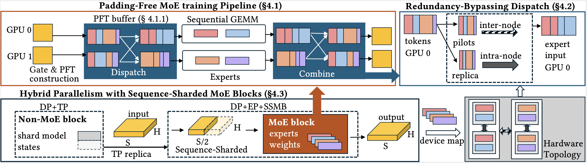
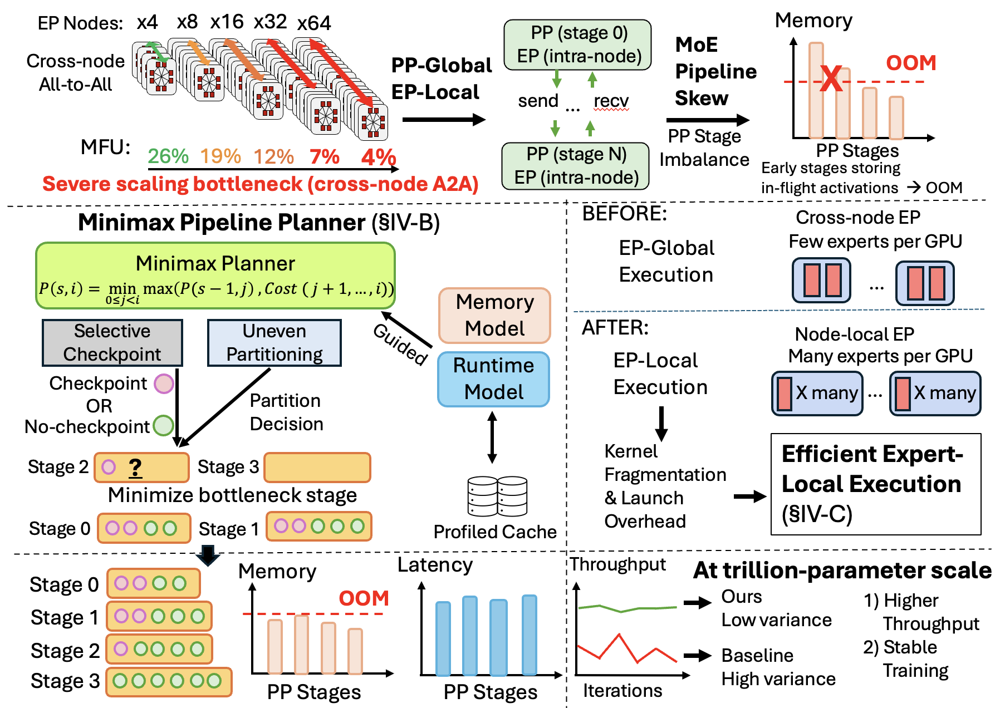
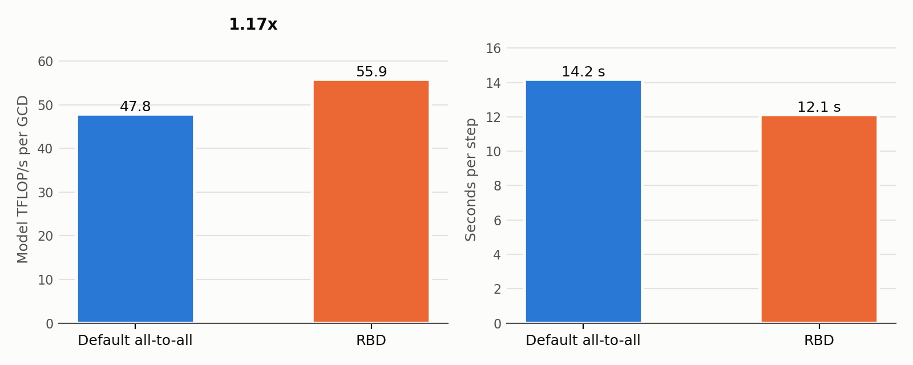
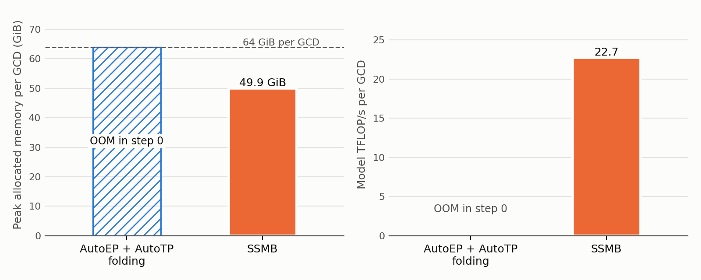
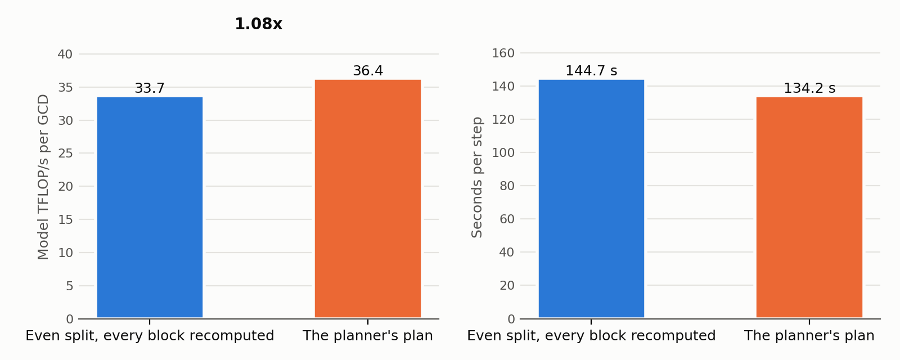

# X-MoE and X-MoE-4D in DeepSpeed



*X-MoE (SC 2025) reduces the cost of expert parallelism across nodes. Redundancy-bypassing dispatch (RBD) sends a token
across the network once per destination node. Sequence-sharded MoE blocks (SSMB) shard the tokens of the MoE block
across the tensor-parallel ranks. Figure from the X-MoE paper.*



*X-MoE-4D (SC 2026) keeps expert parallelism inside each node and scales across nodes with pipeline stages. Its planner
chooses the number of blocks and of recomputed blocks of each stage. Figure 5 of the X-MoE-4D paper.*

This example trains one expert-specialized Mixture-of-Experts decoder with the three mechanisms that X-MoE ([arXiv
2508.13337](https://arxiv.org/abs/2508.13337), SC 2025) and X-MoE-4D (SC 2026) introduced for large MoE training. It
compares each mechanism with DeepSpeed without that mechanism. Two of the mechanisms reduce the cost of expert
parallelism across nodes. RBD sends a token across the network once per destination node. SSMB prevents the ranks of a
tensor-parallel group from routing the same tokens. The third mechanism targets the opposite layout, with expert
parallelism inside a node and pipeline stages across nodes. The planner assigns each stage its own number of blocks and
of recomputed blocks. The [DeepSpeed blog
post](https://github.com/zixianwang2022/DeepSpeed/tree/xmoe/blogs/deepspeed-xmoe) explains why each mechanism works.
This example shows how to run each mechanism and repeats the papers' experiments: X-MoE's Fig. 12 (RBD), X-MoE's Fig.
13 (SSMB), and X-MoE-4D's planner at 173B.

| Mechanism | What it changes | Enabled by | Script |
|---|---|---|---|
| Redundancy-Bypassing Dispatch (RBD) | a token crosses the network once per destination node and is copied to its other experts inside the node | `expert_parallel.comm_backend: "two_level"` | `run_rbd.sh` |
| Sequence-Sharded MoE Blocks (SSMB) | each tensor-parallel rank routes, dispatches and combines only its share of the tokens | `expert_parallel.sequence_sharded_moe: true` | `run_ssmb.sh` |
| X-MoE-4D pipeline planner | each pipeline stage has its own number of blocks and of recomputed blocks | `PipelineModule(layers_per_stage=..., activation_checkpoints_per_stage=...)`, chosen by `python -m deepspeed.runtime.pipe.planner` | `run_planner.sh` |

Each script runs the baseline and the feature on the same model, initial weights and batches. Their losses therefore
agree at the first step, and the runs differ only in speed and memory. The related example
[`training/expert_parallel`](../expert_parallel) shows AutoEP on Hugging Face models. This example adds the X-MoE and
X-MoE-4D features on a decoder defined in `model.py`.

# Requirements and cost

- DeepSpeed with the X-MoE features (version *TBD*), PyTorch (tested with 2.9.1), NumPy. No Hugging Face package is
  required.
- The quick start requires one or two nodes of 8 GPUs with 16 GB or more each. The peak memory of the small model is
  about 10 GB. The reproductions require Slurm. On Frontier (AMD MI250X, 64 GB per GPU die), they require 4 nodes for
  about 7 minutes (RBD), 32 nodes for about 10 minutes (SSMB), and 16 nodes for about 35 minutes including the profile
  (the planner).
- The `tiny` model runs the scripts' logic on CPU in the unit tests.

# Quick start

The following commands run a small model (3.3B parameters) on one or two nodes of 8 GPUs:

```bash
MODEL=small EP=16 bash run_rbd.sh                 # 2 nodes: default all-to-all, then RBD
MODEL=small TP=2 EP=4 bash run_ssmb.sh            # 1 node: folding, folding with recomputation, then SSMB
MODEL=small PP=2 EP=8 NODES=2 bash run_planner.sh # 2 nodes: profile, plan, one or two even splits, then the plan
```

Each run writes `runs/<name>.log` and a CSV with one row per step: loss, seconds, model TFLOP/s per GPU, the largest
allocated and reserved memory of any rank, allocator retries, and routing imbalance (the rows of the busiest
expert-parallel rank divided by the mean, where 1.0 means even routing). `compare.py` then prints the throughput ratio
over the steps after the warm-up, the memory, and the loss gap:

```
runs/ssmb_folding.csv -> runs/ssmb.csv, steps 20-99:
  model TFLOP/s per GPU  5.886 -> 6.831  (1.160x)
  max allocated GiB      7.88 -> 7.89
  max reserved GiB       10.32 -> 10.32
  allocator retries      0 -> 0
  busiest expert rank    1.72 -> 1.72 (rows over the mean; 1.0 is even)
  loss at step 0       11.239780 -> 11.239953; largest gap over all steps 5.57e-03
  mean loss, last 10 steps 10.904468 -> 10.906387 (+0.018%)
```

This output is from a 100-step run of `run_ssmb.sh` on 2 nodes (`STEPS=100 WARMUP=20`, with `--lr-warmup 20` in
`EXTRA`).

`compare.py` refuses to compare two runs that logged different steps, so a run that stopped early never yields a ratio.
If a run fails, its script exits with the exit code of that run.

# Running on a cluster

Every script takes its settings from environment variables and passes its command-line arguments to `train.py`:

| Variable | Meaning |
|---|---|
| `MODEL` | `tiny`, `small`, `63b` or `173b` (see [The model](#the-model)) |
| `LAUNCH` | starts one process per GPU and is followed by the script: `deepspeed --num_gpus 8` (one node) by default, `--num_nodes 2` for `run_rbd.sh` and `run_planner.sh` |
| `STEPS`, `WARMUP` | steps per run, and steps left out of the comparison |
| `EXTRA` | more `train.py` options for every run, for example `--no-grouped-mm` on MI250X with PyTorch 2.9.1 |
| `ROUTING=even` | spread the routing evenly (`--even-routing`, RBD and SSMB) |
| `ROUTING_IMBALANCE` | `run_planner.sh`: the profile measures a block's memory with one rank receiving this many times the mean rows (default 2.5) |
| `TP`, `EP`, `PP`, `NODES`, `GLOBAL_BATCH`, `MBS_LIST`, `RECOMPUTE` | the layout of each script (see the script's header) |

Under Slurm, `LAUNCH` is for example `srun -N16 -n128 --ntasks-per-node=8 --gpus-per-task=1 --gpu-bind=closest python
-u` with `MASTER_ADDR` and `MASTER_PORT` exported. Give each process its own GPU (`--gpus-per-task=1`). When every GPU
is visible to every process, DeepSpeed's first-step batch check under tensor parallelism does not complete.

# Reproducing the papers' experiments

The three experiments below are the ones in the DeepSpeed blog post. They use the papers' model shapes and layouts, the
X-MoE default global batch of 1024 (2048 for the planner), bf16 and ZeRO stage 1. Tensor parallelism shards only the
attention. Each rank holds E / EP whole experts, and an expert-parallel group consists of EP consecutive ranks.
Absolute throughput depends on the expert kernels. These runs used AutoEP's loop of one GEMM per expert
(`--no-grouped-mm`), whereas X-MoE-4D used grouped-GEMM kernels. Each comparison is between two runs on the same
kernels. The RBD and SSMB runs were measured before the DeepSpeed change that splits the expert weights once in this
loop. The change shortens the backward pass of the loop. It is estimated to raise the throughput of these two runs by 2
to 3 %, because they hold only 8 and 4 experts per GPU. The planner run, with 32 experts per GPU, includes the change.

## RBD on one MoE layer (X-MoE Fig. 12)

X-MoE measured RBD on a single MoE layer of its Large model on 32 GPUs with EP 32, where 54.8 % of the routed rows were
redundant. With 256 experts, top-8 routing spread evenly and 4 nodes, the expected rate of redundant rows is the same.

```bash
MODEL=173b EP=32 ROUTING=even STEPS=12 WARMUP=4 EXTRA=--no-grouped-mm \
LAUNCH="srun -N4 -n32 --ntasks-per-node=8 --gpus-per-task=1 --gpu-bind=closest python -u" \
bash run_rbd.sh --layers 1 --global-batch 1024
```

| GPUs | Model | PP x TP x EP | Expert DP | Micro-batch | Global batch | Recompute | Routing |
|---|---|---|---|---|---|---|---|
| 32 (4 nodes) | one block of the Large shape (`--layers 1`) | 1 x 1 x 32 | 1 | 1 | 1024 | none | even |

The two runs differ only in the exchange. The difference of their step times is therefore the net exchange time that
RBD saves. This net time is the time saved on the rows that RBD no longer sends over the network, minus the time of the
added exchange inside the node and of the added copies. The table gives the mean of steps 4-11 on Frontier (AMD MI250X,
ROCm 6.4.1, PyTorch 2.9.1):

| Run | Model TFLOP/s per GPU | Seconds per step | Peak allocated / reserved (GiB) | Loss at step 0 |
|---|---|---|---|---|
| default all-to-all (`rbd_comm`) | 47.80 | 14.19 | 12.45 / 15.87 | 12.259617 |
| RBD (`rbd_two_level`) | **55.85 (1.17x)** | **12.14** | 12.52 / 16.36 | 12.259614 |



*RBD on one MoE layer of X-MoE's Large model, EP 32 over 4 nodes: 47.8 -> 55.9 model TFLOP/s per GPU (1.17x).*

RBD saves 2.05 s of net exchange time per step of 1,024 sequences and allocates 0.07 GiB more memory. Its loss stays
within 1e-5 of the baseline's at every step. The paper timed only the inter-node all-to-all (52.5 % less time). This
experiment measures the whole step, which also contains the attention, the experts and the output layer that RBD does
not change.

## SSMB on the Large model (X-MoE Fig. 13)

X-MoE measured SSMB's memory on its Large model (28 layers, 201B) on 256 GPUs with EP 64 and ZeRO-1, at tensor-parallel
sizes 1 to 4. At TP 1, SSMB does not shard the tokens, because a tensor-parallel group has only one rank. The
comparison therefore runs at TP 4, where the saving is largest.

```bash
MODEL=173b TP=4 EP=64 ROUTING=even STEPS=6 WARMUP=2 EXTRA=--no-grouped-mm \
LAUNCH="srun -N32 -n256 --ntasks-per-node=8 --gpus-per-task=1 --gpu-bind=closest python -u" \
bash run_ssmb.sh --layers 28 --global-batch 1024
```

| GPUs | Model | PP x TP x EP | Expert DP | Micro-batch | Global batch | Recompute | Routing |
|---|---|---|---|---|---|---|---|
| 256 (32 nodes) | X-MoE's Large (`--layers 28`) | 1 x 4 x 64 | 4 | 1 | 1024 | none | even |

The script also runs folding with every block recomputed, the comparison of X-MoE's Fig. 14 (SSMB against activation
checkpointing at similar memory). The run reported here used only `ssmb_folding` and `ssmb`. The configuration
`ssmb_folding_recompute` was not run at this scale. The table gives the mean of steps 2-5 on Frontier (AMD MI250X, ROCm
6.4.1, PyTorch 2.9.1):

| Run | Model TFLOP/s per GPU | Seconds per step | Peak allocated / reserved (GiB) | Loss at step 0 |
|---|---|---|---|---|
| AutoEP + AutoTP folding (`ssmb_folding`) | OOM in step 0 | - | - | - |
| SSMB (`ssmb`) | **22.74** | **62.2** | 49.92 / 52.02 | 12.259960 |



*SSMB on X-MoE's Large model, TP 4 x EP 64 over 32 nodes: folding is OOM in step 0, and SSMB reaches a peak of 49.9
GiB.*

Under folding, the 4 ranks of a tensor-parallel group route the same tokens. SSMB gives each rank a quarter of the
tokens inside the MoE layer. The same layout then trains at a peak of 49.9 GiB, without recomputation and without an
allocator retry.

## The planner at 173B (X-MoE-4D)

X-MoE-4D runs its 173B model with expert parallelism inside each node and pipeline stages across nodes. The planner
profiles the layers on one node. It then chooses the number of blocks and of recomputed blocks of every stage, and the
micro-batch size (1 or 2).

```bash
MODEL=173b PP=8 EP=8 NODES=16 GLOBAL_BATCH=2048 MBS_LIST=1,2 ROUTING_IMBALANCE=1.5 STEPS=6 WARMUP=2 \
EXTRA=--no-grouped-mm \
LAUNCH="srun -N16 -n128 --ntasks-per-node=8 --gpus-per-task=1 --gpu-bind=closest python -u" \
PROFILE_LAUNCH="srun -N1 -n8 --ntasks-per-node=8 --gpus-per-task=1 --gpu-bind=closest python -u" \
bash run_planner.sh
```

| GPUs | Model | PP x TP x EP | Expert DP | Micro-batch | Global batch | Recompute | Routing |
|---|---|---|---|---|---|---|---|
| 128 (16 nodes) | X-MoE-4D's 173B (24 blocks) | 8 x 1 x 8 | 2 | the planner's (it chose 2) | 2048 (64 micro-batches of 2 per pipeline, 9.6 % predicted bubble) | baseline: every block; plan: per stage | the model's own |

The script runs three configurations at the planner's micro-batch size: the even split with every block recomputed, the
even split with the fewest equal recomputations that fit, and the plan. The second configuration is skipped when it
recomputes every block, as in this experiment. `profile_layers.py` measures the time of each layer at the router's own
routing. It measures the memory of a block with one rank receiving `ROUTING_IMBALANCE` times the mean rows (default
2.5). AutoEP drops no token, so the memory of a block grows with the number of rows that its rank receives. This
experiment uses 1.5, because the busiest rank of training received at most 1.29 times the mean rows.

The planner chose micro-batch 2, at which it recomputes 3, 3, 3, 3, 3, 2, 2 and 1 blocks on the 8 stages. Its predicted
step time is 125.7 s, against 138.3 s for recomputing every block and 134.0 s for its best plan at micro-batch 1. The
table gives the measured mean of steps 2-5. The first two rows ran in one job, and the third in a separate job on the
same code:

| Run | Model TFLOP/s per GPU | Seconds per step (predicted) | Peak allocated / reserved, worst stage (GiB) |
|---|---|---|---|
| even split, every block recomputed (`planner_even_all`) | 33.69 | 144.7 (137.7) | 45.31 / 60.23 |
| the plan at the default `ROUTING_IMBALANCE=2.5` | 35.68 (1.06x) | 136.7 (128.3) | 45.25 / 60.55 |
| the plan at `ROUTING_IMBALANCE=1.5` (`planner_plan`) | **36.36 (1.08x)** | **134.2** (125.7) | 49.54 / 60.77 |



*The planner on X-MoE-4D's 173B model, PP 8 x EP 8 over 16 nodes: 33.7 -> 36.4 model TFLOP/s per GPU (1.08x).*

The measured step times are 5 to 7 % above the predictions. The gap grows as the routing becomes less even: the rows of
the busiest expert-parallel rank rise from 1.07 to 1.28 times the mean, and the step time of the plan rises from 129 s
to 143 s. The plan at 1.5 leaves a smaller memory margin than the plan at 2.5. On stages 1-4, its allocated peak
exceeded the predicted peak by 0.2 to 1.1 GiB, and stages 5-7 needed four allocator retries at step 5, with up to 60.8
GiB reserved. At 2.5, every stage's allocated peak stayed below the predicted peak of its 1F1B phase (41.8-45.3 GiB
against 43.1-51.1 GiB), and the last stage needed one allocator retry. A value below the imbalance that training
reaches can run out of memory. For a long run, keep the default or measure the imbalance first.

All runs show a loss increase at step 4 (12.1 to 21.4 for the even split). The likely causes are the random tokens and
the absence of a learning-rate warm-up. Add `--lr-warmup N` through `EXTRA` for a run that should converge. A plan
changes only which blocks are recomputed, so the runs compute the same values. The plan at 1.5 matches the even split
at steps 0-4 and differs by 3e-5 at step 5. The plan at 2.5 matches at step 0 and then differs: by 4e-5 at step 1, 2e-2
at step 3 and 0.77 at step 4. In an earlier run before the expert-loop change, that plan matched the even split at
every logged step (six decimals), and the even split above reproduced that earlier run at every step. The cause of the
difference is not yet determined.

# Same model, same losses

The loss of each feature stays close to the loss of its baseline. The table covers 100 steps of the small model (2
nodes, learning rate warmed up over 20 steps to 1e-4) for SSMB and RBD, and the 6 steps of the 173B planner experiment:

| Script | Layout | Routing | Baseline -> feature | Mean loss of the last 10 steps | Largest gap at any step |
|---|---|---|---|---|---|
| `run_ssmb.sh` | TP 2 x EP 4 | own | folding -> SSMB | 10.9045 -> 10.9064 (+0.018 %) | 0.006 |
| `run_ssmb.sh` | TP 2 x EP 4 | own | folding with every block recomputed -> SSMB | 10.9053 -> 10.9064 (+0.010 %) | 0.009 |
| `run_rbd.sh` | EP 16 over 2 nodes | even | default all-to-all -> RBD | 10.8808 -> 10.8796 (-0.011 %) | 0.008 |
| `run_planner.sh` | 173B, PP 8 x EP 8 | own | even split, every block recomputed -> plan (`ROUTING_IMBALANCE=1.5`) | identical at steps 0-4 (6 steps in total) | 3e-5 (step 5) |

At step 0, the losses of SSMB and RBD agree with those of their baselines to within 1e-3, because these features add
the same numbers in a different order in bf16. The planner changes only where recomputation happens. Its run is
discussed in the planner section above.

# The model

`model.py` defines a GPT-style decoder: token embedding, L blocks of pre-norm causal attention and a pre-norm mixture
of experts, a final norm and the output layer. The MoE block has a router `gate` and `experts` stored as two 3-D
tensors, so DeepSpeed's AutoEP converts it through a `moe_layer_pattern`. The attention has separate q, k, v and o
projections, which AutoTP shards with four rules. The same layers form a plain module (pipeline size 1) or a
`PipelineModule`.

| `--model` | Blocks | Hidden | Heads | Experts | Top-k | Expert FFN | Sequence | Parameters |
|---|---|---|---|---|---|---|---|---|
| `tiny` | 4 | 64 | 4 | 8 | 2 | 32 | 16 | 0.28M (CPU tests) |
| `small` | 8 | 2048 | 16 | 64 | 6 | 939 | 2048 | 3.3B |
| `63b` | 32 | 5120 | 40 | 128 | 6 | 1024 | 4096 | 68.3B (63.6 x 2^30) |
| `173b` | 24 | 7168 | 56 | 256 | 8 | 1365 | 4096 | 186.0B (173.3 x 2^30) |
| `173b --layers 28` | 28 | 7168 | 56 | 256 | 8 | 1365 | 4096 | 216.9B (202.0 x 2^30): X-MoE's Large |

The papers name their models by parameters counted in units of 2^30. X-MoE's experts have two matrices. AutoEP's
experts are gated and have three matrices (SwiGLU). The expert FFN here is therefore 2/3 of X-MoE's (1536 and 2048),
which keeps the parameter count of every expert unchanged. `--layers` sets the number of blocks of any shape. The
parameters are allocated but not written until AutoEP and AutoTP have placed them, so a model larger than the host
memory of a node can be built. Each tensor is then filled from a generator seeded by its name, so the initial weights
are the same for every layout.

No router auxiliary loss is added. The loss is the language-model loss. An untrained router can send far more rows to
some expert-parallel ranks than to others. `--even-routing` replaces the router's scores with seeded noise so that the
tokens spread evenly. It is a measurement condition, and every result above states which routing it used.

# Training options

Each script above calls `train.py`, which can also be run on its own. The following commands run SSMB on one node and
the 173B plan on 16 nodes. The second command uses the `best.txt` that `run_planner.sh` wrote. On Slurm, use the `srun`
launch shown above instead of a hostfile:

```bash
deepspeed --num_gpus 8 train.py --model small --tp 2 --ep 4 --ssmb --steps 50
deepspeed --hostfile hostfile --num_nodes 16 --num_gpus 8 train.py --model 173b --pp 8 --ep 8 --global-batch 2048 \
    --plan runs/best.txt
```

| Option | Meaning |
|---|---|
| `--model` | the shape: `tiny`, `small`, `63b` or `173b` (see [The model](#the-model)) |
| `--pp`, `--tp`, `--ep` | pipeline stages, tensor-parallel size (AutoTP), expert-parallel size (AutoEP); the rest is data parallelism |
| `--mbs`, `--global-batch` | micro-batch size and sequences per step (gradient accumulation provides the remaining factor) |
| `--layers` | the number of blocks, overriding the shape's |
| `--steps`, `--warmup` | steps to run (20 by default), and the first steps left out of the summary (5 by default; these steps are still logged) |
| `--lr`, `--lr-warmup`, `--clip-grad` | learning rate (1e-4), steps of linear learning-rate warm-up (0), gradient clipping (1.0) |
| `--rbd` | `comm_backend: "two_level"` (pipeline size 1; under tensor parallelism only with `--ssmb`) |
| `--ssmb` | `sequence_sharded_moe: true` (requires `--tp` 2 or more, pipeline size 1) |
| `--plan FILE` | the planner's `BEST` line: blocks and recomputed blocks of every stage, and the micro-batch size |
| `--layers-per-stage`, `--recompute-per-stage` | the same lists, set manually |
| `--recompute` | baseline recomputation: `none`, `all`, or N (pipeline: the first N blocks of every stage of the even split) |
| `--even-routing` | replace the routers' scores by seeded noise (pipeline size 1) |
| `--data-path`, `--data-dtype` | a flat file of token ids (for example Megatron-LM's `.bin`) and its element type (`uint16`); random tokens otherwise |
| `--seed` | seed of the initial weights and of the random tokens (1234) |
| `--metrics-out` | the CSV of one row per step that `compare.py` reads (rank 0) |
| `--zero` | ZeRO stage (1 by default; the planner's memory model covers stage 1) |
| `--no-grouped-mm` | AutoEP's sequential expert loop (used on MI250X with PyTorch 2.9.1) |

# Files

| File | Purpose |
|---|---|
| `model.py` | the decoder, its shapes, the FLOP count, the DeepSpeed settings of each feature, the initialization |
| `train.py` | one training run, logged step by step |
| `profile_layers.py` | measures the embedding, a block and the output layer for the planner |
| `common.sh`, `run_rbd.sh`, `run_ssmb.sh`, `run_planner.sh` | baseline and feature, one script per mechanism |
| `compare.py` | compares two runs |
| `images/` | the figures of this README |
